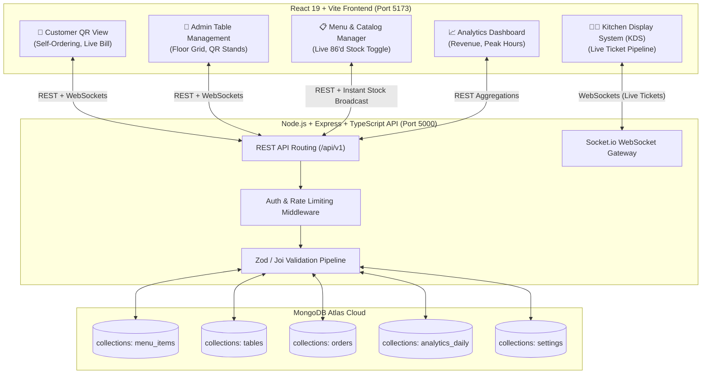

# Backend API Specification & Architecture Guide
## Project: Velvet Bloom Bistro • QR Ordering & Aura POS / KDS System
**Target Architecture**: Node.js + Express.js + TypeScript + MongoDB Atlas + WebSockets (Socket.io)  
**Currency Standard**: Indian Rupees (₹ - INR) | **Tax Standard**: 5% Restaurant GST  
**Document Version**: 1.0.0  

---

## 📌 Instructions for the Backend Developer

> [!IMPORTANT]
> ### 🚨 Mandatory Deliverable for Frontend Integration
> Upon implementing these endpoints, you are required to generate and hand back:
> 1. **`apiClient.ts` / `apiService.ts`**: A ready-to-use Axios / Fetch client module containing all typed API functions and matching TypeScript interfaces.
> 2. **`types.ts`**: Pure TypeScript interface definitions for all models (`MenuItem`, `Order`, `Table`, `Analytics`, `CartItem`, etc.).
> 3. **`FRONTEND_INTEGRATION.md`**: A quick-start markdown guide listing base URLs, environment variables, WebSocket event listeners, and sample integration snippets for our React 19 + Vite frontend.
> 4. **Postman / Bruno Collection (`collection.json`)**: Containing all documented endpoints with sample requests for local testing.

---

## 1. System Architecture Overview



---

## 2. MongoDB Atlas Mongoose Schemas (TypeScript)

### 2.1. `MenuItem` Schema (`collections: menu_items`)
```typescript
import { Schema, model, Document } from 'mongoose';

export interface IMenuItem extends Document {
  name: string;
  category: 'Chef Specials' | 'Small Plates' | 'Mains & Grills' | 'Artisanal Cocktails' | 'Desserts';
  price: number; // in INR (₹) e.g., 1850
  prepTimeMinutes: number; // e.g., 12
  dietaryTags: ('Gluten-Free' | 'Vegetarian' | 'Signature' | 'Spicy' | 'Vegan')[];
  isSignature: boolean;
  isAvailable: boolean; // false = 86'd / Sold Out
  soldCount: number;
  description: string;
  image: string; // URL
  customizable: boolean;
  customizationOptions?: {
    temperatures?: string[]; // ['Medium Rare', 'Medium', 'Well Done']
    sides?: string[]; // ['Truffle Puree', 'Grilled Broccolini']
  };
  marginPercent?: number; // e.g. 74.2
  createdAt: Date;
  updatedAt: Date;
}

const MenuItemSchema = new Schema<IMenuItem>({
  name: { type: String, required: true, trim: true, index: true },
  category: { 
    type: String, 
    required: true, 
    enum: ['Chef Specials', 'Small Plates', 'Mains & Grills', 'Artisanal Cocktails', 'Desserts'],
    index: true 
  },
  price: { type: Number, required: true, min: 0 },
  prepTimeMinutes: { type: Number, default: 10 },
  dietaryTags: [{ type: String }],
  isSignature: { type: Boolean, default: false },
  isAvailable: { type: Boolean, default: true, index: true },
  soldCount: { type: Number, default: 0 },
  description: { type: String, default: '' },
  image: { type: String, required: true },
  customizable: { type: Boolean, default: false },
  customizationOptions: {
    temperatures: [{ type: String }],
    sides: [{ type: String }]
  },
  marginPercent: { type: Number, default: 70 }
}, { timestamps: true });

export const MenuItemModel = model<IMenuItem>('MenuItem', MenuItemSchema);
```

### 2.2. `Table` Schema (`collections: tables`)
```typescript
export interface ITable extends Document {
  tableNumber: string; // "01", "04", "12"
  zone: string; // "Indoor Main", "Indoor Center", "Patio Garden", "Rooftop Bar"
  zoneGroup: 'Indoor' | 'Patio' | 'Rooftop';
  capacity: string; // "2-top", "4-top", "6-top"
  status: 'available' | 'occupied' | 'reserved' | 'cleaning';
  currentBill: number; // in INR (₹)
  ordersCount: number;
  seatedMinutes: number;
  seatedAt?: Date;
  assignedServer: string; // "Marco V.", "Elena R.", "Unassigned"
  qrToken: string; // unique secure token for QR URL
  isActive: boolean;
}

const TableSchema = new Schema<ITable>({
  tableNumber: { type: String, required: true, unique: true, index: true },
  zone: { type: String, required: true },
  zoneGroup: { type: String, required: true, enum: ['Indoor', 'Patio', 'Rooftop'] },
  capacity: { type: String, default: '4-top' },
  status: { 
    type: String, 
    required: true, 
    enum: ['available', 'occupied', 'reserved', 'cleaning'], 
    default: 'available',
    index: true 
  },
  currentBill: { type: Number, default: 0 },
  ordersCount: { type: Number, default: 0 },
  seatedMinutes: { type: Number, default: 0 },
  seatedAt: { type: Date },
  assignedServer: { type: String, default: 'Unassigned' },
  qrToken: { type: String, required: true, unique: true },
  isActive: { type: Boolean, default: true }
}, { timestamps: true });

export const TableModel = model<ITable>('Table', TableSchema);
```

### 2.3. `Order` Schema (`collections: orders`)
```typescript
export interface IOrderItem {
  menuItemId: Schema.Types.ObjectId;
  name: string;
  qty: number;
  unitPrice: number;
  notes?: string;
  customization?: {
    temperature?: string;
    side?: string;
  };
}

export interface IOrder extends Document {
  orderNumber: string; // e.g. "ORD-042"
  tableNumber: string;
  zone: string;
  status: 'new' | 'in-prep' | 'ready' | 'served' | 'cancelled';
  items: IOrderItem[];
  specialRequest?: string;
  subtotal: number; // in INR (₹)
  taxGST: number; // 5% GST in INR (₹)
  total: number; // subtotal + taxGST
  splitBillRequested: boolean;
  timestamps: {
    orderedAt: Date;
    prepStartedAt?: Date;
    readyAt?: Date;
    servedAt?: Date;
  };
}

const OrderSchema = new Schema<IOrder>({
  orderNumber: { type: String, required: true, unique: true, index: true },
  tableNumber: { type: String, required: true, index: true },
  zone: { type: String, required: true },
  status: { 
    type: String, 
    required: true, 
    enum: ['new', 'in-prep', 'ready', 'served', 'cancelled'], 
    default: 'new',
    index: true 
  },
  items: [{
    menuItemId: { type: Schema.Types.ObjectId, ref: 'MenuItem', required: true },
    name: { type: String, required: true },
    qty: { type: Number, required: true, min: 1 },
    unitPrice: { type: Number, required: true },
    notes: { type: String, default: '' },
    customization: {
      temperature: { type: String },
      side: { type: String }
    }
  }],
  specialRequest: { type: String, default: '' },
  subtotal: { type: Number, required: true },
  taxGST: { type: Number, required: true },
  total: { type: Number, required: true },
  splitBillRequested: { type: Boolean, default: false },
  timestamps: {
    orderedAt: { type: Date, default: Date.now },
    prepStartedAt: { type: Date },
    readyAt: { type: Date },
    servedAt: { type: Date }
  }
}, { timestamps: true });

export const OrderModel = model<IOrder>('Order', OrderSchema);
```

### 2.4. `Setting` Schema (`collections: settings`)
```typescript
export interface ISetting extends Document {
  key: string; // e.g., "global_settings"
  emergencyHold: boolean; // pause QR ordering if kitchen overwhelmed
  restaurantName: string;
  gstPercent: number; // 5.0
  currency: string; // "INR"
  currencySymbol: string; // "₹"
}
```

---

## 3. Real-Time WebSockets Architecture (Socket.io)

### Rooms & Namespaces:
- **`room:kds`**: Joined by kitchen wallboards & expediter terminals.
- **`room:table:<tableNumber>`**: Joined by diners seated at that table.
- **`room:admin`**: Joined by manager dashboards.

### Event Definitions:
| Event Name | Direction | Payload | Description |
| :--- | :--- | :--- | :--- |
| `order:created` | Server &rarr; KDS, Admin | `{ order: IOrder }` | Fired when customer sends order to kitchen. Triggers sound chime & confetti. |
| `order:status_updated` | Server &rarr; Diner, KDS | `{ orderId, status, tableNumber }` | Fired when KDS bumps order (`new` &rarr; `in-prep` &rarr; `ready` &rarr; `served`). |
| `menu:stock_toggled` | Server &rarr; Diner, Admin | `{ menuItemId, isAvailable, name }` | Instant 86'd broadcast: grays out item on all diner phones in real time. |
| `server:call_waiter` | Client &rarr; Server &rarr; Admin | `{ tableNumber, zone, timestamp }` | Dispatched when guest taps **"Call Server"**. |
| `emergency_hold:changed` | Server &rarr; Diners | `{ emergencyHold: boolean }` | Disables checkout if kitchen is at peak load. |

---

## 4. RESTful API Endpoints

### 4.1. Customer-Facing Endpoints (Public / Table QR)

#### `GET /api/v1/customer/table/:tableNumber`
* **Purpose**: Validate QR code and fetch table details when diner arrives.
* **Params**: `tableNumber` (e.g. `04` or `T-04`).
* **Response (200 OK)**:
```json
{
  "success": true,
  "data": {
    "tableNumber": "04",
    "zone": "Indoor Center",
    "zoneGroup": "Indoor",
    "status": "occupied",
    "currentBill": 4200,
    "activeOrdersCount": 2,
    "isEmergencyHold": false
  }
}
```

#### `GET /api/v1/customer/menu`
* **Purpose**: Fetch digital menu for diner. Automatically hides deleted items, and flags 86'd items.
* **Query Parameters**:
  - `category` *(optional)*: `Chef Specials` | `Small Plates` | `Mains & Grills` | `Artisanal Cocktails` | `Desserts`
  - `dietary` *(optional)*: `Vegetarian` | `Gluten-Free` | `Signature` | `Spicy`
  - `search` *(optional)*: string
* **Response (200 OK)**:
```json
{
  "success": true,
  "count": 7,
  "data": [
    {
      "id": "660c1f4e8b34a12345678901",
      "name": "Sakura A5 Wagwag Tataki",
      "category": "Chef Specials",
      "price": 1850,
      "prepTimeMinutes": 12,
      "dietaryTags": ["Gluten-Free"],
      "isSignature": true,
      "isAvailable": true,
      "description": "Seared Japanese black wagyu, smoked cherry blossom shoyu, daikon oroshi & yuzu reduction.",
      "image": "https://lh3.googleusercontent.com/...",
      "customizable": false
    },
    {
      "id": "660c1f4e8b34a12345678907",
      "name": "Crispy Robata Pork Belly",
      "category": "Small Plates",
      "price": 850,
      "prepTimeMinutes": 10,
      "dietaryTags": ["Spicy"],
      "isSignature": false,
      "isAvailable": false,
      "description": "Slow-braised then flash-crisped Berkshire pork belly, hot mustard glaze.",
      "image": "https://images.unsplash.com/...",
      "customizable": false
    }
  ]
}
```

#### `POST /api/v1/customer/orders`
* **Purpose**: Diner clicks **"Send Order to Kitchen Line"**. Computes GST (5%), generates order number, updates table bill, and triggers `order:created` socket to KDS.
* **Request Body**:
```json
{
  "tableNumber": "04",
  "zone": "Indoor Center",
  "items": [
    {
      "menuItemId": "660c1f4e8b34a12345678901",
      "qty": 1,
      "notes": "Rare preparation requested"
    },
    {
      "menuItemId": "660c1f4e8b34a12345678904",
      "qty": 2,
      "notes": "Light ice"
    },
    {
      "menuItemId": "660c1f4e8b34a12345678903",
      "qty": 1,
      "notes": "Extra black vinegar"
    }
  ],
  "specialRequest": "Please bring cocktails immediately, separate plates requested.",
  "splitBill": false
}
```
* **Response (201 Created)**:
```json
{
  "success": true,
  "message": "Order sent to Kitchen Line! Firing now.",
  "data": {
    "orderId": "ORD-042",
    "tableNumber": "04",
    "status": "new",
    "subtotal": 4000,
    "taxGST": 200,
    "total": 4200,
    "estimatedPrepMinutes": 14,
    "timestamp": "2026-10-14T21:50:00.000Z"
  }
}
```

#### `POST /api/v1/customer/call-server`
* **Purpose**: Paging service staff from mobile browser.
* **Request Body**:
```json
{
  "tableNumber": "04",
  "zone": "Indoor Center"
}
```
* **Response (200 OK)**:
```json
{
  "success": true,
  "message": "Waiter notified for Table 04. Staff will be with you shortly."
}
```

---

### 4.2. Admin Table & QR Management Endpoints

#### `GET /api/v1/admin/tables`
* **Purpose**: Fetch all 24 tables for floor plan / grid view.
* **Query Parameters**: `zone` (`Indoor` | `Patio` | `Rooftop` | `All`), `status` (`occupied` | `available` | `reserved` | `cleaning`)
* **Response (200 OK)**:
```json
{
  "success": true,
  "summary": {
    "totalTables": 24,
    "occupied": 18,
    "available": 6,
    "loadPercentage": 75
  },
  "data": [
    {
      "id": "660c1f4e8b34a12345678910",
      "tableNumber": "01",
      "zone": "Indoor Main",
      "zoneGroup": "Indoor",
      "capacity": "4-top",
      "status": "occupied",
      "currentBill": 6850,
      "ordersCount": 3,
      "seatedMinutes": 42,
      "assignedServer": "Marco V.",
      "qrUrl": "https://velvetbloom.menu/t01?token=vb_sec_9918"
    }
  ]
}
```

#### `PATCH /api/v1/admin/tables/:id/status`
* **Purpose**: Quick toggle of table state (e.g. Set Free, Cleaning, Reserved, Occupied).
* **Request Body**: `{ "status": "available" }`
* **Response (200 OK)**:
```json
{
  "success": true,
  "message": "Table 01 status updated to available",
  "data": { "id": "660c1f4e8b34a12345678910", "status": "available", "currentBill": 0 }
}
```

#### `POST /api/v1/admin/emergency-hold`
* **Purpose**: Halt or resume incoming digital QR orders.
* **Request Body**: `{ "hold": true }`
* **Response (200 OK)**:
```json
{
  "success": true,
  "emergencyHold": true,
  "message": "Emergency hold activated. Digital ordering paused."
}
```

---

### 4.3. Admin Kitchen Display System (KDS) Endpoints

#### `GET /api/v1/admin/kds/orders`
* **Purpose**: Fetch live tickets grouped for KDS Kanban columns.
* **Response (200 OK)**:
```json
{
  "success": true,
  "data": {
    "new": [
      {
        "id": "ORD-045",
        "tableNumber": "11",
        "zone": "Patio Garden",
        "status": "new",
        "elapsedMinutes": 3,
        "items": [
          { "name": "Kyoto Sakura Smoked Highball", "qty": 3, "notes": "Double shot on one" }
        ],
        "specialRequest": "",
        "total": 4100
      }
    ],
    "inPrep": [
      {
        "id": "ORD-042",
        "tableNumber": "04",
        "zone": "Indoor Center",
        "status": "in-prep",
        "elapsedMinutes": 8,
        "items": [
          { "name": "Sakura A5 Wagyu Tataki", "qty": 1, "notes": "Gluten-Free, Rare" }
        ],
        "specialRequest": "Please bring cocktails immediately",
        "total": 4200
      }
    ],
    "ready": [],
    "served": []
  }
}
```

#### `PATCH /api/v1/admin/kds/orders/:orderId/bump`
* **Purpose**: Advances ticket in pipeline:
  - `new` &rarr; `in-prep`
  - `in-prep` &rarr; `ready` (Hot on Pass)
  - `ready` &rarr; `served` (Delivered)
* **Request Body**: `{ "status": "ready" }`
* **Response (200 OK)**:
```json
{
  "success": true,
  "message": "Order ORD-042 bumped to ready",
  "data": {
    "orderId": "ORD-042",
    "status": "ready",
    "updatedAt": "2026-10-14T21:55:00.000Z"
  }
}
```

---

### 4.4. Admin Menu & Catalog Management Endpoints

#### `GET /api/v1/admin/menu`
* **Purpose**: Fetch complete menu catalog with food cost margins and 86'd status.
* **Response (200 OK)**:
```json
{
  "success": true,
  "count": 38,
  "data": [
    {
      "id": "660c1f4e8b34a12345678901",
      "name": "Sakura A5 Wagyu Tataki",
      "category": "Chef Specials",
      "price": 1850,
      "prepTimeMinutes": 12,
      "dietaryTags": ["Gluten-Free"],
      "isSignature": true,
      "isAvailable": true,
      "soldCount": 142,
      "marginPercent": 71.0,
      "image": "https://..."
    }
  ]
}
```

#### `PATCH /api/v1/admin/menu/:id/toggle-stock`
* **Purpose**: **Instant 86'd (Sold Out) Toggle**. Flips availability and emits socket event to all diner devices.
* **Request Body**: `{ "isAvailable": false }`
* **Response (200 OK)**:
```json
{
  "success": true,
  "message": "Dish 'Crispy Robata Pork Belly' marked as 86'd (Sold Out)",
  "data": { "id": "660c1f4e8b34a12345678907", "isAvailable": false }
}
```

#### `POST /api/v1/admin/menu`
* **Purpose**: Create and publish a new dish to digital QR menus.
* **Request Body**:
```json
{
  "name": "Hokkaido Scallop Ceviche",
  "category": "Chef Specials",
  "price": 1250,
  "prepTimeMinutes": 10,
  "dietaryTags": ["Gluten-Free"],
  "isSignature": true,
  "description": "Hand-dived scallops, yuzu kosho marinade, purple shiso oil.",
  "image": "https://images.unsplash.com/..."
}
```
* **Response (201 Created)**:
```json
{
  "success": true,
  "message": "Dish published to live table QR menus successfully",
  "data": { "id": "660c1f4e8b34a12345678999", "name": "Hokkaido Scallop Ceviche", "price": 1250 }
}
```

---

### 4.5. Admin Analytics & Reporting Endpoints

#### `GET /api/v1/admin/analytics/overview`
* **Purpose**: Summary metrics in Indian Rupees (₹).
* **Response (200 OK)**:
```json
{
  "success": true,
  "currency": "INR",
  "currencySymbol": "₹",
  "data": {
    "grossDailyRevenue": 184250,
    "revenueChangePercent": 14.8,
    "completedOrders": 184,
    "ordersChangeVsLunch": 22,
    "averageTicketSize": 1250,
    "averageTableTurnMinutes": 42
  }
}
```

#### `GET /api/v1/admin/analytics/peak-hours`
* **Response (200 OK)**:
```json
{
  "success": true,
  "peakHour": "7:00 PM",
  "peakOrders": 48,
  "data": [
    { "hour": "12 PM", "orders": 18 },
    { "hour": "1 PM", "orders": 32 },
    { "hour": "2 PM", "orders": 24 },
    { "hour": "5 PM", "orders": 15 },
    { "hour": "6 PM", "orders": 38 },
    { "hour": "7 PM", "orders": 48 },
    { "hour": "8 PM", "orders": 42 },
    { "hour": "9 PM", "orders": 28 },
    { "hour": "10 PM", "orders": 14 }
  ]
}
```

#### `GET /api/v1/admin/analytics/category-split`
* **Response (200 OK)**:
```json
{
  "success": true,
  "data": [
    { "category": "Mains & Grills", "percentage": 44, "revenue": 81070 },
    { "category": "Artisanal Cocktails", "percentage": 26, "revenue": 47905 },
    { "category": "Small Plates & Starters", "percentage": 18, "revenue": 33165 },
    { "category": "Desserts", "percentage": 12, "revenue": 22110 }
  ]
}
```

#### `GET /api/v1/admin/analytics/top-sellers`
* **Response (200 OK)**:
```json
{
  "success": true,
  "data": [
    { "name": "Sakura A5 Wagyu Tataki", "category": "Chef Specials", "sold": 142, "revenue": 262700, "marginPercent": 71 },
    { "name": "Kyoto Sakura Smoked Highball", "category": "Cocktails", "sold": 210, "revenue": 157500, "marginPercent": 82 },
    { "name": "Duck Magret & Hibiscus Glaze", "category": "Mains & Grills", "sold": 98, "revenue": 142100, "marginPercent": 73 },
    { "name": "Black Truffle & Wild Mushroom Gyoza", "category": "Small Plates", "sold": 185, "revenue": 120250, "marginPercent": 78 },
    { "name": "Matcha & Ruby Blossom Lava Cake", "category": "Desserts", "sold": 84, "revenue": 46200, "marginPercent": 80 }
  ]
}
```

---

## 5. Required Return Deliverable for Frontend Integration

> [!NOTE]
> When your backend service is ready, please generate and provide the following **`apiClient.ts`** structure so we can drop it straight into our React application (`src/services/apiClient.ts`):

```typescript
// Sample contract to be returned by backend developer
import axios from 'axios';

const api = axios.create({
  baseURL: process.env.VITE_API_BASE_URL || 'http://localhost:5000/api/v1',
  headers: { 'Content-Type': 'application/json' }
});

// Customer API
export const getTableDetails = (tableNumber: string) => api.get(`/customer/table/${tableNumber}`);
export const getCustomerMenu = (params?: { category?: string; dietary?: string; search?: string }) => 
  api.get('/customer/menu', { params });
export const submitOrder = (orderData: any) => api.post('/customer/orders', orderData);
export const callServer = (tableNumber: string, zone: string) => 
  api.post('/customer/call-server', { tableNumber, zone });

// Admin Tables API
export const getAdminTables = (params?: { zone?: string; status?: string }) => 
  api.get('/admin/tables', { params });
export const updateTableStatus = (id: string, status: string) => 
  api.patch(`/admin/tables/${id}/status`, { status });
export const toggleEmergencyHold = (hold: boolean) => 
  api.post('/admin/emergency-hold', { hold });

// Admin KDS API
export const getKdsOrders = () => api.get('/admin/kds/orders');
export const bumpOrderStatus = (orderId: string, status: string) => 
  api.patch(`/admin/kds/orders/${orderId}/bump`, { status });

// Admin Menu Manager API
export const getAdminMenu = (params?: { category?: string; search?: string }) => 
  api.get('/admin/menu', { params });
export const toggleItemStock = (id: string, isAvailable: boolean) => 
  api.patch(`/admin/menu/${id}/toggle-stock`, { isAvailable });
export const createMenuItem = (dishData: any) => 
  api.post('/admin/menu', dishData);

// Admin Analytics API
export const getAnalyticsOverview = () => api.get('/admin/analytics/overview');
export const getPeakHours = () => api.get('/admin/analytics/peak-hours');
export const getCategorySplit = () => api.get('/admin/analytics/category-split');
export const getTopSellers = () => api.get('/admin/analytics/top-sellers');
```

---

## 6. Environment Variables (`.env.example`)

```ini
PORT=5000
NODE_ENV=development
MONGO_URI=mongodb+srv://<username>:<password>@cluster0.mongodb.net/velvet_bloom_bistro?retryWrites=true&w=majority
CORS_ORIGIN=http://localhost:5173
JWT_SECRET=super_secret_restaurant_key_9182
DEFAULT_GST_PERCENT=5.0
DEFAULT_CURRENCY=INR
```

